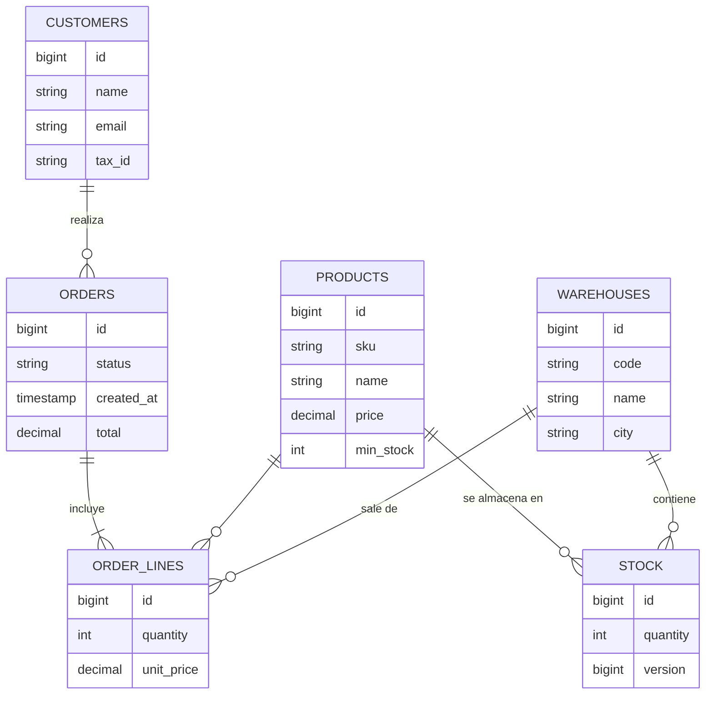

# Inventory & Orders API


API REST para gestionar **pedidos e inventario en varios almacenes**: productos, stock por almacén, clientes y pedidos que reservan stock de forma segura aunque lleguen a la vez.

Proyecto personal hecho con **Java 21 y Spring Boot 3** para practicar backend tal y como se trabaja en empresa: capas bien separadas, migraciones de base de datos, tests de integración contra una base de datos real y CI.

## Funcionalidades

- CRUD de productos (con búsqueda y paginación), almacenes y clientes.
- Stock por producto y almacén.
- **Pedidos**: cada línea sale del almacén con más unidades disponibles; si ninguno puede servirla, el pedido se rechaza entero.
- **Cancelación** de pedidos devolviendo las unidades al almacén de origen.
- **Aviso de stock bajo** asíncrono cuando un producto cae por debajo de su mínimo.
- Errores en formato estándar [RFC 9457 – Problem Details](https://www.rfc-editor.org/rfc/rfc9457).
- Documentación interactiva con Swagger UI.

## Decisiones técnicas

| Problema | Solución |
|---|---|
| Dos pedidos compran la última unidad a la vez | Bloqueo optimista con `@Version` en `Stock`: solo uno confirma, el otro recibe `409 Conflict`. Lo demuestra `OrderConcurrencyIT`. |
| Pedido con varias líneas y una falla | `@Transactional`: o se reserva todo, o no se toca nada. |
| El precio de un producto cambia | La línea de pedido guarda el precio del momento de la compra. |
| Avisos de stock que no ralenticen la API | Evento de dominio + `@TransactionalEventListener(AFTER_COMMIT)` + `@Async`. |
| Esquema de base de datos versionado | Flyway (`src/main/resources/db/migration`). Hibernate solo valida. |
| Exponer entidades JPA en la API | Nunca: entrada y salida con `record` DTO y validación con Bean Validation. |

## Modelo de datos



## Arrancar

**Con Docker (recomendado):**

```bash
docker compose up --build
```

**En local** (con un PostgreSQL propio o solo la base de datos del compose):

```bash
docker compose up -d db
mvn spring-boot:run
```

- API: http://localhost:8080/api
- Swagger UI: http://localhost:8080/swagger-ui.html
- Salud: http://localhost:8080/actuator/health

Al arrancar se cargan datos de ejemplo (3 almacenes, 5 productos y 2 clientes).

## Endpoints principales

| Método | Ruta | Descripción |
|---|---|---|
| GET | `/api/products?q=monitor&page=0&size=20` | Buscar productos |
| POST | `/api/products` | Crear producto |
| PUT | `/api/products/{id}` | Modificar producto |
| GET | `/api/warehouses` | Listar almacenes |
| GET | `/api/stock?productId=1` | Stock de un producto por almacén |
| PUT | `/api/stock` | Fijar stock de un producto en un almacén |
| GET / POST | `/api/customers` | Listar / crear clientes |
| POST | `/api/orders` | Crear pedido |
| GET | `/api/orders?customerId=1` | Listar pedidos |
| POST | `/api/orders/{id}/cancel` | Cancelar pedido |

Ejemplo:

```bash
curl -X POST http://localhost:8080/api/orders \
  -H "Content-Type: application/json" \
  -d '{"customerId": 1, "lines": [{"productId": 2, "quantity": 3}, {"productId": 4, "quantity": 10}]}'
```

## Tests

```bash
mvn test     # unitarios (Mockito) y de controlador (MockMvc)
mvn verify   # además, tests de integración con PostgreSQL real vía Testcontainers (requiere Docker)
```

GitHub Actions ejecuta `mvn verify` en cada push.

## Estructura

```
src/main/java/com/mario/inventory
├── config/        configuración (paginación, async)
├── domain/        entidades JPA y reglas de negocio
├── repository/    Spring Data JPA
├── service/       casos de uso y transacciones
├── event/         eventos de dominio y listeners
├── exception/     excepciones de negocio
└── web/           controladores REST, DTOs y manejo de errores
```

## Roadmap

- [x] Productos, almacenes, stock y clientes
- [x] Pedidos con reserva de stock y cancelación
- [x] Control de concurrencia con bloqueo optimista + test de integración
- [x] Docker Compose y CI con GitHub Actions
- [ ] Seguridad con Spring Security + JWT y roles (ADMIN, COMERCIAL, ALMACÉN)
- [ ] Factura del pedido en PDF
- [ ] Informes de ventas por mes, producto y cliente
- [ ] Auditoría de cambios (quién y cuándo)
- [ ] Mensajería con RabbitMQ para los avisos de stock
- [ ] Despliegue en AWS

## Autor

**Mario Llorente de la Rosa** · Desarrollador Java y .NET · [LinkedIn](https://www.linkedin.com/in/USUARIO)
